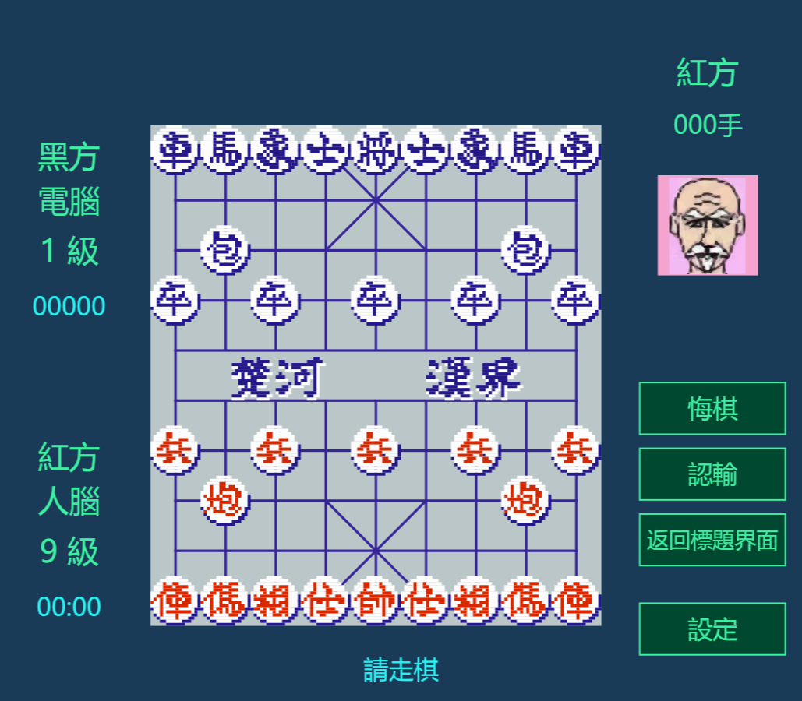

# FC 中国象棋 · 老头对战

一款为《原神》千星奇域制作的单人人机象棋游戏。像素棋盘、黑方的「包」和老头头像沿用 FC 风格，困难模式也保留了原版慢悠悠的回棋节奏。



## 怎么玩

你执红先走。先点己方棋子，再点目标交叉点。游戏保留马腿、象眼、炮架等基本走法，允许不应将。吃掉黑将即获胜，红帅被吃或主动认输即落败。

| 模式 | 玩法 |
| --- | --- |
| 困难 | 标准开局，保留 FC 的长思考节奏。老头每手算完还会额外等约 10–40 秒。 |
| 快速模式 | 标准开局，和困难共用同一套 AI 搜索，回棋更快。 |
| 自定义模式 | 开局前可替换红方棋子，也可在己方半场空位加子。选择「全部改子」可以保留红帅、用同一种棋子填满其余 44 个位置后直接开局。 |

对局中可以悔棋、认输或返回模式菜单。结束后可以回看棋盘或再来一局。自定义玩法示例见 [44 车开局截图](records/screenshots/player-feedback-2026-11-17-custom-rooks.png)。

## 本地试玩

需要 Node.js 22.19 或更新版本。首次克隆仓库或移动项目目录后，在仓库根目录安装依赖并初始化本机配置。

```sh
git clone https://github.com/xcr1234/fc-chess.git
cd fc-chess
npm ci
npm run setup
```

试玩千星 Lua 版时，用浏览器模拟器打开项目存档。

```sh
npm run preview -- --file fc-chess.save.json
```

命令会先构建 `dist/main.lua`，再打开浏览器。在模拟器切到「试玩」，点击「▶ 启动」。修改 Lua 后运行 `npm run build:game`，刷新页面并重新启动试玩。

只想体验画面和操作时，可以运行独立的 HTML 原型。原型采用独立的演示 AI。

```sh
npm run preview:html
```

打开 [本地 HTML 原型](http://127.0.0.1:4173/)。停止当前预览可按 `Ctrl+C`。

## 开发与验证

| 路径 | 内容 |
| --- | --- |
| [src/main.lua](src/main.lua) | 千星客户端脚本入口 |
| [src/game/](src/game/) | 棋盘规则、对局状态与 AI |
| [src/ui/](src/ui/) | 千星界面、交互和棋子动画 |
| [fc-chess.save.json](fc-chess.save.json) | 游戏的 UI、脚本索引和挂载关系 |
| [prototype/](prototype/) | HTML 试玩原型 |
| [tests/](tests/) | Lua 回归、规则用例及模拟器测试存档 |

```sh
npm test                    # 构建、存档引用与本机配置检查
npm run test:lua            # 核心走棋与对局回归
npm run test:prototype      # HTML 原型回归
npm run check:game-cases    # 模拟器用例格式检查
npm run build:lua           # 构建单文件 dist/main.lua
npm run build:game          # 构建游戏并同步存档引用
```

`npm run setup` 按当前目录生成项目内 MCP 配置。`npm run check` 检查模拟器和知识库 MCP 的工具列表，`npm run check -- --online` 额外检查一次在线查询。需要代理时可用 `npm run setup -- --proxy <代理地址>` 配置。在 [AGENTS.md](AGENTS.md) 查看项目开发约定。

## 千星编辑器发布

在本机配置目标脚本的完整路径后，按以下命令检查并更新单文件 Lua。

```sh
npm run deploy:lua -- --dry-run
npm run deploy:lua
```

发布会重新构建，替换前备份旧文件，复制后核对 SHA-256。目标有外部改动时先比较并将有效修改合并回源码。编辑器沿用目标文件的脚本映射和挂载，保存后重新试玩。正式存档和测试存档的 `scripts[].source` 均为空，模拟器从 `dist/main.lua` 读取脚本。分享可运行工程时请同时携带存档和构建产物。

- 构建、日志与目标路径配置见 [Lua 构建与发布](docs/lua-modules.md)。映射、挂载与真机检查见 [真机导入说明](docs/device-handoff.md)。
- 玩法与 AI 细节见 [策划案](docs/gdd.md) 和 [AI 设计](docs/ai-design.md)。美术制作见 [美术方案](docs/art-bible.md) 和 [图片拟合指南](docs/image-fitting.md)。
- 当前进度与验证结果见 [制作计划](docs/production-plan.md)、[试玩记录](records/playtest.md) 和 [玩家反馈](records/player-feedback-2026-11-17.md)。
