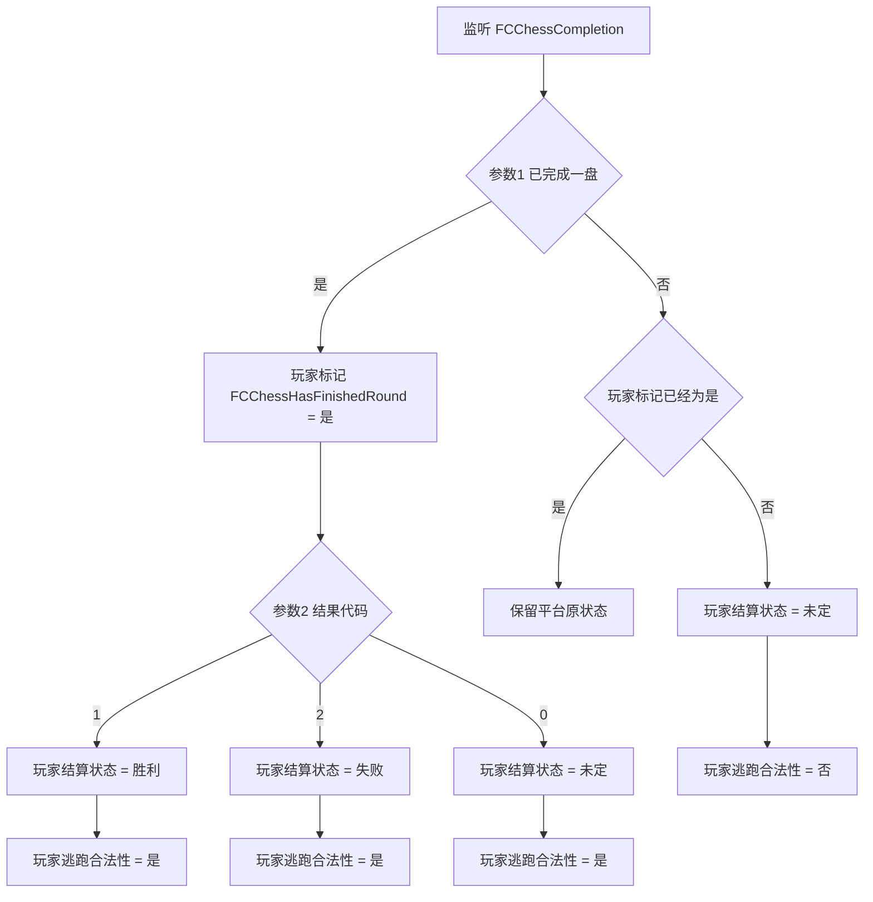

# 下完一盘后允许正常退出

本项目按用户选择：棋局结束后允许通过原生ESC菜单正常退出；**不调用「结算关卡」**，不自动结束本次游玩。玩家可继续回看、悔棋、再来一局或返回标题。

Lua已发送完成请求。以下服务端接线需在真实奇域编辑器中配置，单独复制Lua不能替代接线；模拟器接收探针只记录请求，不代表已经修改原生平台退出属性。

## 1. 新建信号

在信号管理器中新建 **`FCChessCompletion`**，按下面顺序添加参数并应用修改：

| 编号（从1开始） | 建议名称 | 类型 | 含义 |
| --- | --- | --- | --- |
| 1 | 已完成一盘 | 布尔值 Bool | 首次启动否；一盘结束后是 |
| 2 | 本盘结果 | 整数 Int | 0=未定，1=胜利，2=失败 |

这些数字是本项目的传输代码，不是平台枚举值。设置结算状态时按分支选择平台的「未定 / 胜利 / 失败」，不要把整数直接接到枚举端口。

## 2. 准备玩家标记

给玩家添加普通布尔自定义变量 **`FCChessHasFinishedRound`**，默认「否」。使用本次关卡中的玩家变量，不做跨次存档。

该标记用于保护已完成结果：官方说明客户端容器重建、传送或断线重连会让Lua重新初始化。初始化请求为否时，如果服务端已经记录完成，应保留原来的允许退出和胜负状态。

## 3. 服务端接线

在服务端节点图添加【监听信号】，选择 `FCChessCompletion`。两个平台设置节点的「玩家实体」都指向**本次发送信号的玩家**，参照现有BGM链路中已核验的玩家取法；不要跨接另一个监听事件的实体出参，也不要将FCChessHost控件容器当成玩家。

按参数1「已完成一盘」做双分支：

**为是：**

1. 【设置自定义变量】：目标=该玩家，变量名=`FCChessHasFinishedRound`，变量值=是；无需触发变量变化事件。
2. 按参数2做多分支：
   - 1：执行【设置玩家结算成功状态】，结算状态选「胜利」。
   - 2：执行同一节点，结算状态选「失败」。
   - 0：执行同一节点，结算状态选「未定」。
3. 每条结果分支后执行【设置玩家逃跑合法性】：玩家实体=该玩家，「是否合法」=是。接线到此结束。

**为否：**

1. 【获取自定义变量】：目标=该玩家，变量名=`FCChessHasFinishedRound`，类型=布尔值。
2. 已经是：不修改任何平台状态，保护已完成记录。
3. 仍为否：执行【设置玩家结算成功状态】=未定，再执行【设置玩家逃跑合法性】=否。

以上只有玩家属性设置，所有分支都不连接「结算关卡」。黑棋为Lua中的AI，不另找一个“黑方玩家”进行结算。

## 行为与日志

- 首次启动请求 `(否,0)`；尚未下完就返回标题，不会解锁完成。
- 吃黑将请求 `(是,1)`；红帅被吃或确认认输请求 `(是,2)`；中性的“双方暂无可走棋”结束请求 `(是,0)`。
- 取消认输、选子、悔棋不生成新结果。已完成后回看/悔棋/再来/返回标题不清除标记；下一盘结束时更新最近一盘结果。
- 重绘不重复发送。脚本销毁不发送撤销完成请求；BGM的停播信号仍为独立的`FCChessBGM`。
- 日志应出现 `[fc-chess][completion-request] completed=true outcome=1 sequence=1`（失败为2）。该日志证明Lua已发请求，最终ESC结果仍需接线后真机验证。
- 信号定义缺失或类型错误时，完成模块每个新状态只记录一次发送错误，不阻断棋盘。定义好两参数并保存、重新试玩后再验收。

## 真机验收

1. 新启动、未结束一盘时直接ESC，仍为未完成。
2. 赢棋、落败、确认认输分别验证：结果页仍可回看/再来，最后ESC正常退出；取消认输仍不解锁。
3. 完成一盘后再开新局、返回标题或悔棋，不清除已经玩完一盘的记录。
4. 若测试重连/容器重建，确认新的`(否,0)`请求没有覆盖服务端已完成标记。

官方依据：客户端《[控件API](https://act.mihoyo.com/ys/ugc/tutorial/detail/mhtakr07vej4)》《[客户端控件和客户端脚本](https://act.mihoyo.com/ys/ugc/tutorial/detail/mhbgxf0nynww)》，服务端《[关卡结算](https://act.mihoyo.com/ys/ugc/tutorial/detail/mhx1du08nhwo)》及《[执行节点](https://act.mihoyo.com/ys/ugc/tutorial/detail/mhw66orrrfkm)》中的两个玩家结算设置节点。
